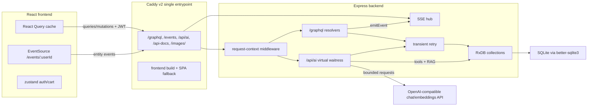

# Restaurant Management System

Full-stack MERN restaurant platform — menu, orders, reservations, tables and admin settings with real-time updates, role-based access and an optimized GraphQL API. Includes an optional customer-facing AI virtual waitress with tool calling, retrieval-augmented knowledge and safely confirmed order/reservation drafts.

## Features

- **Dashboard** – aggregated stats via `dashboardStats` (orders/reservations by status, revenue, tables occupancy, today counts, recent orders). Single query replaces 3 list fetches.
- **Menu** – CRUD (admin), category filter, `available` flag. Cards are memoized, lazy-loaded images.
- **Orders** – create/edit (pending), status flow `pending → preparing → completed/cancelled`, `completed/cancelled` deletable. Table occupancy check (`Table is busy`), `TableSelect` dropdown.
- **Reservations** – create/edit (`confirmed`), `completed`/`cancelled` deletable, staff status select.
- **Tables** – `tableCount` from `RestaurantSettings` drives `TableSelect` everywhere; `tables` query computes busy from `pending`/`preparing` orders + `confirmed` reservations.
- **Settings (admin)** – Restaurant details (name/logo/address/phone/email/`tableCount`), Users (create/delete/role change), Categories (CRUD). Tabs are lazy-loaded.
- **Real-time** – SSE events (`menu:changed`, `orders:changed`, `reservations:changed`, `categories:changed`, `users:changed`, `settings:changed`, `tables:changed`, `logs:changed`) auto-patch `react-query` caches (see Architecture).
- **AI virtual waitress (optional)** – `/assistant` chat grounded in live menu/restaurant data and approved knowledge. Tools can prepare server-priced order and reservation drafts; writes happen only after the customer presses Confirm, then the backend revalidates ownership, expiry, availability, table/price state and idempotency. Disabled by default (`AI_ENABLED=false`).
- **Waiter interpreter (optional)** – `/interpreter` is a staff/admin-only, text-first translator for conversations between a waiter and a customer. It keeps originals and translations visible, flags safety-sensitive wording for human verification, never calls business tools, and stores no history. Optional browser speech input/output degrade to text.

## Tech Stack

- **Frontend:** React 18 (CRA 5 + TypeScript), React Router 6, `@tanstack/react-query` 5, `zustand` (auth/cart), `react-hook-form` + `zod`, `graphql-request` + `@apollo/client` (`gql` docs), `@mui/material` styled with **Tailwind CSS**, native `EventSource` (SSE), manual `fetch` client for `/api/ai`, Testing Library/Jest
- **Backend:** Node 18+, Express 4, RxDB 17 + SQLite (`@basepurpose/rxdb-sqlite`, `better-sqlite3`), TypeScript (`moduleResolution: node16` — imports require `.js` suffix), GraphQL (`graphql` + `express-graphql`, `graphiql: true`), OpenAI-compatible LLM/embedding client via native `fetch` (no AI SDK), `jsonwebtoken` + `bcryptjs`, `node-sse-hub` (SSE), `node-retry-kit` (transient retry), `async-context-kit` (request correlation), `zod`, `moment`, `swagger-jsdoc`/`swagger-ui-express`
- **Auth:** JWT Bearer (`protect` → `req.user`), `admin`/`staff` guards; frontend `useAuthStore` persists `user+token` in `localStorage`
- **Testing:** Backend Jest + `ts-jest` (ESM), Frontend `react-scripts` Jest + Testing Library

## Project Structure

```
backend/
  config/db.ts                RxDB connection wrapper
  ai/                         virtual waitress: config, provider, agent, tools,
                              RAG, conversation/draft lifecycle, confirm actions,
                              rate limiting, `/api/ai` router
  services/                   shared availability, server-priced order and
                              customer reservation services
  knowledge/                  approved customer-facing Markdown for optional RAG
  graphql/
    typeDefs.ts               SDL (User, MenuItem, Category, Order, Reservation, RestaurantSettings, TableStatus, DashboardStats, StatusCount)
    helpers/
      formatters.ts           formatUser, formatMenuItem/Category/Order/Reservation/RestaurantSettings, getOrCreateRestaurantSettings
      auth.ts                 requireAuth, requireAdmin, requireStaffOrAdmin
    resolvers/
      auth.ts, menu.ts, order.ts, reservation.ts, category.ts, settings.ts, tables.ts, dashboard.ts
      index.ts                merged root resolvers
    schema.ts                 buildSchema(typeDefs) + root
    validation.ts             Zod schemas + validate()
  models/                     User, MenuItem, Category, Order (indexed), Reservation (indexed), RestaurantSettings
  middleware/auth.ts
  routes/                     REST routers (legacy, commented out in server.ts)
  server.ts                   Express + /graphql + /api-docs + socket init
  socket.ts                   emitEvent / initSocket
  seeds.ts
  tests/                      Jest suites (validation, formatters, auth, typeDefs, resolvers)
  jest.config.cjs
  tsconfig.json               node16

frontend/
  src/
    api/queries.ts            graphql-request + useAuthStore token, mapId/mapArray, use* hooks (staleTime 30-60s, dashboardStats invalidation)
    api/ai.ts                 typed `/api/ai` client (chat, conversation restore, confirm)
    graphql/queries.ts        gql documents (GET_MENU_ITEMS, GET_DASHBOARD_STATS, etc.)
    store/                    authStore (zustand), cartStore
    validation/schemas.ts     Zod schemas for forms
    hooks/useSocket.ts        invalidates queries on socket events (incl. dashboardStats)
    components/
      PageHeader.tsx          reusable flex justify-between header (replaces repeated className)
      assistant/              chat message, menu cards, citations, draft confirmation
      FilterBar.tsx, StatusBadge.tsx, SectionCard.tsx, TableSelect.tsx, LoadingSpinner, etc.
      pages/
        DashboardStatCard.tsx, MenuCategoryFilter.tsx, OrderCard.tsx, ReservationCard.tsx, TableCard.tsx,
        MenuItemCard.tsx (memo + lazy image), MenuItemForm.tsx, OrderForm.tsx, ReservationForm.tsx,
        UserForm.tsx, UserTable.tsx, CategorySection.tsx, RestaurantSection.tsx
    pages/                    Dashboard, Menu, Assistant, Orders, Reservations, Tables, Settings, Home, Login, Register
    App.tsx                   lazy routes + global useIsFetching/useIsMutating overlay
    setupTests.ts
  tailwind.config.js, postcss.config.js   Tailwind at root, utilities in src/index.css (@layer components)
```

## Getting Started

### Prerequisites

- Node.js 18+
- No external database — data is stored locally via RxDB/SQLite
  (`better-sqlite3`)

### Environment

Create `backend/.env` from `backend/.env.example`:

```
PORT=5000
JWT_SECRET=your_jwt_secret
```

Frontend proxy is `http://localhost:5000` (`frontend/package.json:proxy`) or set `REACT_APP_GRAPHQL_URL=http://localhost:5000/graphql`. The AI client defaults to same-origin `/api/ai`; override with `REACT_APP_AI_API_URL` only if it is hosted elsewhere. AI environment variables are optional and documented in [`backend/.env.example`](backend/.env.example) and [AI Virtual Waitress](#ai-virtual-waitress-optional).

### Install & Run

```bash
# Backend
cd backend
npm install --legacy-peer-deps
npm run seed        # seed sample data
npm run ai:ingest   # optional: embed backend/knowledge/*.md for RAG
npm run dev         # tsx + nodemon (handles .js extensions)

# Frontend
cd frontend
npm install --legacy-peer-deps
npm start           # CRA dev server
# open http://localhost:3000  (GraphiQL at http://localhost:5000/graphql)
```

### Build

```bash
cd backend && npm run build     # tsc -> dist/
npm start                        # node dist/server.js

cd frontend && npm run build    # build/
```

### Caddy (production reverse proxy)

Root `Caddyfile` (Caddy v2, validated with `caddy validate`) exposes one public
entrypoint: `/graphql*`, `/events*` (SSE, unbuffered via `flush_interval -1`),
`/api/ai*` and `/api-docs*` proxy to the backend (`$BACKEND_UPSTREAM`, default
`localhost:5000`); everything else serves the frontend `build/` output mounted
at `/srv/frontend` with SPA fallback to `index.html`. Full HTTPS deployment
guide (DNS, firewall, commands): [`docs/DEPLOYMENT.md`](docs/DEPLOYMENT.md).

```bash
# Build the frontend with same-origin API URLs, then serve via Caddy
cd frontend && REACT_APP_GRAPHQL_URL=/graphql REACT_APP_WS_URL= npm run build
# cp -r build /srv/frontend  (or mount ./frontend/build -> /srv/frontend)
DOMAIN=restaurant.example.com BACKEND_UPSTREAM=localhost:5000 caddy run
```

`REACT_APP_WS_URL=` (empty) means same-origin `/events`
(`frontend/src/eventSource.ts`); a local-dev variant proxying to the CRA dev
server (`$FRONTEND_UPSTREAM`, default `localhost:3000`) is commented in the
Caddyfile.

### Testing

```bash
# Backend — 26 suites, 234 tests (incl. AI config/provider/tools/RAG/actions/security)
cd backend && npm test                 # jest --runInBand
npm run test:coverage
npm run build

# Frontend — 30 suites, 192 tests (incl. /assistant chat, drafts, accessibility)
cd frontend && CI=true npm test -- --watchAll=false
npx tsc --noEmit
CI=true npm run build
```

## Seed Credentials

| Role | Email | Password |
|------|-------|----------|
| Admin | admin@restaurant.com | admin123 |
| Staff | staff@restaurant.com | staff123 |
| Customer | john@example.com | customer123 |
| Customer | jane@example.com | customer123 |
| Customer | bob@example.com | customer123 |

## API

The core domain API is **GraphQL** at `POST /graphql` (`backend/graphql/*`, `express-graphql`). The AI virtual waitress adds a narrowly scoped REST API at `/api/ai` (see below). Legacy REST routers in `backend/routes/*` remain commented out in `server.ts`.

- **Swagger:** `GET /api-docs` (REST docs, legacy)
- **GraphiQL:** enabled at `/graphql` when `graphiql: true`

### Key Queries / Mutations

```graphql
query GetDashboardStats {
  dashboardStats {
    totalOrders pendingOrders completedOrders totalRevenue
    totalReservations confirmedReservations
    totalMenuItems availableMenuItems totalUsers totalCategories
    totalTables busyTables freeTables todayOrders todayReservations
    recentOrders { id totalAmount status }
    ordersByStatus { status count }
  }
}
query GetMenuItems($category: String) { menuItems(category: $category) { id name price category } }
mutation CreateOrder($items: [OrderItemInput!]!, $tableNumber: Int) { createOrder(items: $items, tableNumber: $tableNumber) { id totalAmount } }
```

All `graphql-request` calls in `frontend/src/api/queries.ts` attach `Authorization: Bearer <token>` from `useAuthStore`.

## AI Virtual Waitress (optional)

`/assistant` is a responsive customer chat that answers from live restaurant tools and, when configured, approved knowledge documents with citations. Guests can ask read-only questions; signed-in customers also get persisted history and can prepare order/reservation drafts. The feature is **disabled by default** and does not affect the core GraphQL API when `AI_ENABLED=false`.

### Configuration

Use any endpoint that implements the OpenAI-compatible `/v1` chat and embeddings APIs. Provider credentials stay server-side; never put them in `REACT_APP_*` variables.

Hosted example:

```bash
AI_ENABLED=true
AI_LLM_BASE_URL=https://api.openai.com/v1
AI_LLM_API_KEY=your_key_here
AI_LLM_MODEL=gpt-4o-mini
AI_EMBEDDING_MODEL=text-embedding-3-small
```

Local Ollama example (an API key is optional for local endpoints):

```bash
AI_ENABLED=true
AI_LLM_BASE_URL=http://localhost:11434/v1
AI_LLM_MODEL=llama3.1
AI_EMBEDDING_BASE_URL=http://localhost:11434/v1
AI_EMBEDDING_MODEL=nomic-embed-text
```

Embeddings fall back to the LLM base URL/API key when `AI_EMBEDDING_BASE_URL`/`AI_EMBEDDING_API_KEY` are omitted. Set `AI_RAG_ENABLED=false` if you only want tool-based answers; the knowledge tool then reports that retrieval is unavailable instead of inventing an answer. Other limits (timeouts, iterations, tool calls, history, RAG top-K/score, draft TTL, per-IP rate limits, IANA time zone) are documented with defaults in `backend/.env.example`.

### Knowledge ingestion and re-indexing

Approved Markdown/text lives in `backend/knowledge/`. After configuring embeddings:

```bash
cd backend
npm run ai:ingest                    # seed all .md/.txt files in backend/knowledge
npm run ai:ingest -- --dir ./path    # ingest another directory
```

`AI_AUTO_SEED_KNOWLEDGE=true` seeds the built-in directory on startup only when there are no documents or every document failed embedding. Ingestion stores a checksum, chunk count and embedding status; failures leave the document visible as `failed` with no chunks and do not fabricate retrieval results. Admins can manage documents through the API below; `POST /api/ai/knowledge/:id/reindex` regenerates chunks/embeddings after a model or content change.

### Model tools

Read-only: `search_menu`, `get_menu_item_details`, `get_restaurant_information`, `check_reservation_availability`, `search_restaurant_knowledge`.

Draft-only (authenticated): `prepare_order_draft`, `prepare_reservation_draft`.

There is deliberately **no** create/confirm/write tool available to the model. Tools use zod-validated arguments, allow-listed services, bounded output and timeouts; the model cannot issue SQL, shell commands, arbitrary HTTP requests or direct RxDB queries. Retrieved documents and customer messages are treated as untrusted data.

### API

| Method | Path | Access | Purpose |
| --- | --- | --- | --- |
| `GET` | `/api/ai/health` | public | Enabled/configured status without secrets |
| `POST` | `/api/ai/chat` | optional JWT | Bounded chat; guests send recent history, signed-in users persist conversations |
| `GET` | `/api/ai/conversations/:id` | JWT, owner | Restore the caller's conversation |
| `POST` | `/api/ai/actions/confirm` | JWT, draft owner | Explicitly confirm one draft |
| `GET` | `/api/ai/knowledge` | admin | List knowledge documents/status |
| `GET` | `/api/ai/knowledge/:id` | admin | Read a knowledge document |
| `POST` | `/api/ai/knowledge` | admin | Ingest a document |
| `PUT` | `/api/ai/knowledge/:id` | admin | Update and re-ingest a document |
| `DELETE` | `/api/ai/knowledge/:id` | admin | Delete a document and chunks |
| `POST` | `/api/ai/knowledge/:id/reindex` | admin | Re-chunk and re-embed a document |

Requests are body-validated, rate-limited per IP and bounded by request/provider/tool timeouts. Errors return a stable `{ error: { code, message } }` shape; provider bodies, prompts, keys and stacks are not forwarded.

### Confirmation and write safety

1. The model may call a draft tool. The backend prices the order from current menu documents or checks reservation availability, then stores a draft with an expiry and a server-side price/availability snapshot.
2. The customer reviews the draft in `/assistant` and presses **Confirm**. A chat message such as “yes” is never consent.
3. `POST /api/ai/actions/confirm` authenticates the customer, enforces draft ownership and expiry, re-checks table count/occupancy, current menu prices and reservation availability, then writes through the shared order/reservation services.
4. Writes use deterministic ids (`ai-<draftId>`) plus an in-process draft lock, so duplicate clicks/retries return the original result instead of creating duplicates.
5. Successful actions emit the existing SSE events and write an activity log. The model never chooses the final price, user identity or confirmation state.

### Limitations

- The database has no opening-hours, per-table capacity or dietary/allergen fields. The assistant explicitly reports these as unverified and must not infer them.
- Reservation availability follows the existing conservative convention: confirmed reservations occupy their table for the whole requested date and today's active orders occupy tables. `capacityVerified`/`openingHoursVerified` are returned as `false`.
- Prices are displayed in USD (`$`) because the app has no currency setting.
- Retrieval uses bounded in-process cosine similarity over RxDB chunks (`AI_RAG_MAX_CHUNKS`), not a dedicated vector database. Replace `VectorStore` if the knowledge base grows beyond that design.
- Rate limiting, draft processing locks and embedding search are single-backend-process features. Deterministic write ids remain the durable duplicate guard.
- The AI customer flow is additive. The existing GraphQL reservation mutation remains staff/admin-only, and no payment integration is added.
- Provider integration is covered by mocked tests; a live LLM/embedding smoke test requires provider credentials and is not run automatically.

### Multilingual waiter interpreter (optional)

`/interpreter` is a separate, staff/admin-only tool for a human waiter talking with a customer. It is **not** the conversational virtual waitress: it has no system prompt built from the assistant role, no conversation persistence and no access to the tool registry, drafts or confirm endpoints. The translation provider is called with an explicit source/target language, `tools` omitted and a bounded restaurant glossary; it therefore cannot create an order, reservation or any other write.

Configuration uses the same AI gate plus optional translation overrides:

```bash
AI_ENABLED=true
AI_INTERPRETER_ENABLED=true          # default; false disables the page/endpoint
AI_TRANSLATION_BASE_URL=https://api.openai.com/v1   # defaults to AI_LLM_BASE_URL
AI_TRANSLATION_API_KEY=your_key      # defaults to AI_LLM_API_KEY
AI_TRANSLATION_MODEL=gpt-4o-mini     # defaults to AI_LLM_MODEL
```

Translation is disabled unless AI is enabled and a translation base URL + model resolve. Keys stay on the backend. The language list is curated by the app (code, English/native labels, text direction and browser speech locale); it does **not** assert that the configured provider supports every pair. Translation quality and coverage for a given pair must be verified by the restaurant.

API (served under `/api/ai`):

| Method | Path | Access | Purpose |
| --- | --- | --- | --- |
| `GET` | `/api/ai/interpreter/languages` | public | Curated languages plus whether the interpreter is enabled; no secrets |
| `POST` | `/api/ai/interpreter/translate` | staff/admin JWT | Translate one bounded message in either direction |

Requests are zod-validated, capped by `AI_TRANSLATION_MAX_INPUT_CHARS`, rate-limited per IP by `AI_INTERPRETER_RATE_LIMIT_MAX`, time-bounded and cancelled when the client disconnects. Responses include the original, translation, detected source language and conservative `uncertain` / `requiresHumanVerification` flags; malformed provider output and provider errors map to safe errors without forwarding prompts, keys or stacks.

Safety behavior:

- Allergy/dietary terms, cross-contamination wording, negation, quantities, prices/currency and reservation details are flagged for explicit human verification. Numeric tokens are compared between source and translation; a mismatch is surfaced.
- The translation prompt receives only stored restaurant/menu names, categories and truncated descriptions as terminology. Prices, availability, allergens, dietary facts and policies are not included, so the model cannot repeat or infer them as facts.
- A translated allergy or dietary statement is **never** proof that a dish is safe. Waiters must confirm with the customer and the restaurant before acting.
- The page keeps both the original and translation visible, supports manual edit/re-translate, and keeps history in React state only. Nothing is written to RxDB or a log. Messages are sent to the configured provider, so normal provider data-handling rules apply.
- Browser speech recognition and speech synthesis are optional adapters. Microphone access is requested only after **Dictate** is pressed, transcripts are inserted for review, and text mode remains fully functional if the APIs are missing or permission is denied. Playback only happens after **Listen** and can be stopped.

Local run and smoke test:

1. Start the backend and frontend as described above, sign in as `staff` or `admin`, and open `/interpreter`.
2. Confirm the language selectors load. With `AI_ENABLED=false` or missing translation config, the page must show a disabled notice and typing must not enable Translate.
3. With a configured provider, translate a simple greeting in both directions and confirm the original stays visible. Rehearse an allergy/price sentence and confirm the verification warning appears.
4. Deny microphone permission (or use a browser without Web Speech) and confirm typing/translation still works.

Automated checks (provider calls are mocked; no live credentials are required):

```bash
cd backend && npm run build && npx jest --runInBand
cd frontend && npx tsc --noEmit
cd frontend && CI=true npx react-scripts test --watchAll=false --runInBand
cd frontend && npm run build
```

## Auth & Roles

- `protect` → JWT → `req.user`; `admin` → `role==='admin'`; `staff` → `admin|staff`.
- Frontend `useAuth()` + `ProtectedRoute`; backend `requireAuth`/`requireAdmin` checks.
- Gates: Menu add/edit → admin; Settings → admin; Tables → staff/admin; Orders/Reservations filters & status changes respect role.

## Domain Rules

- Categories via DB (`/settings` → `CategorySection`), `MenuItem.category` refs DB (no enum).
- Menu edit: click card → form with DB defaults.
- Order: `pending` editable; `completed`/`cancelled` deletable. Reservation: `confirmed` editable; `completed`/`cancelled` deletable.
- `tableCount` in `RestaurantSettings` drives `TableSelect`; busy tables are labeled but selectable → backend error `Table is busy`.

## Styling

- Use **Tailwind** `className` for MUI components (`<Button className="!bg-[#e94560]">`) — avoid `sx` except for MUI layout props.
- Utilities in `frontend/src/index.css` `@layer components`: `section-card`, `card`, `form-panel`/`form-input-sm`, `table-card`, `filter-bar`, `page-heading`, `btn-*`, `spinner`, etc. Never use inline `style=` or new CSS files.

## Notes

- **TypeScript quirk:** `backend/tsconfig.json` is `node16` → relative imports must use `.js` (e.g. `from './config/db.js'`). Run via `tsx` in dev (`npm run dev`), `tsc` in build. Third-party packages that ship dual CJS+ESM builds (`node-retry-kit`, `async-context-kit`, `node-sse-hub`) resolve correctly at every runtime, but `tsc` reports TS1479 on their static imports — see the documented `@ts-expect-error` in `backend/retry.ts`.
- **Optimization:** lean queries + indexes (`Order.status+tableNumber`, `Reservation.status+tableNumber+date`, `MenuItem.category+available`), `Promise.all` in `dashboardStats`, `staleTime`/`gcTime` in react-query, `React.memo`/`useMemo`/`useCallback`, lazy images/tabs, `dashboardStats` invalidated on all relevant mutations/socket events.
- **Recent refactor:** `PageHeader` (`flex justify-between items-center mb-2`) extracted; `backend/graphql/schema.ts:674` split into `typeDefs` + `helpers` + 8 resolver modules; frontend `OrderList`/`ReservationList`/`UserSection`/`Tables` split into `OrderCard`/`ReservationCard`/`UserTable`/`TableCard` etc.

## Architecture




1. **React frontend** — routes in `frontend/src/pages/`, sections in `src/components/pages/`, data via typed React Query hooks (`src/api/queries.ts`), client state in zustand. The AI page uses a small typed `fetch` client (`src/api/ai.ts`). No direct DB access; server contracts are GraphQL + SSE for restaurant operations and `/api/ai` for the assistant.
2. **RxDB** — server-side embedded database (`backend/config/rxdb.ts`, 12 collections: 7 domain + 5 AI conversation/knowledge/draft collections). There is **no** RxDB client/replication on the frontend: "synchronization" is GraphQL for reads/writes plus SSE notifications that patch the React Query cache. No redundant sync framework sits on top.
3. **GraphQL** — core domain API at `POST /graphql` (`express-graphql`, SDL in `graphql/typeDefs.ts`, resolvers per domain). Errors are coded `AppError`s surfaced as `extensions.code`; the frontend renders them only through `getGraphQLErrorMessage`. The optional `/api/ai` REST surface is intentionally separate so model/tool traffic cannot widen GraphQL permissions.
4. **Express backend** — `server.ts` awaits `connectDB()` before `listen()`; JWT Bearer auth (`protect`/`admin`/`staff`) enforced in resolvers via `requireAuth`/`requireAdmin`/`requireStaffOrAdmin`, mirrored by frontend route/gate hiding.
5. **SQLite** — persistence via `@basepurpose/rxdb-sqlite` (`better-sqlite3`), single file (`restaurant-db.db`, volume-mounted in Docker). Concurrent writes can surface transient `SQLITE_BUSY`/`SQLITE_LOCKED` — handled by retry (7), never by adding infrastructure.
6. **SSE** — live invalidation events (`menu/orders/reservations/categories/users/settings/tables/logs:changed`, deletes as `{ id, deleted: true }`) from `backend/sse.ts` (`node-sse-hub`); the frontend `useEventSource` hook upserts/removes entities in the React Query cache and invalidates derived queries (`tables`, `dashboardStats`). Heartbeat comments every 15s keep the stream alive through Caddy (`flush_interval -1`); the browser `EventSource` reconnects on its own.
7. **Retry handling** — `backend/retry.ts` (`node-retry-kit`): exponential backoff, full jitter, 3 retries, 1s max delay, retry _only_ transient failures (SQLite lock codes/messages, retryable network codes/statuses, attempt timeouts). `AppError`s (validation/auth/permission/not-found/conflict) never retry; the original error is rethrown unwrapped so GraphQL codes are preserved; attempts are logged with the request correlation id. Applied to order writes (`orders.insert/update/remove`) and the best-effort activity-log insert.
8. **Request/correlation IDs** — `backend/requestContext.ts` (`async-context-kit`): middleware mints/propagates `x-request-id` (validated, echoed on the response), visible through all async work via `AsyncLocalStorage`. Access logs carry the id; `getLogContext()` exposes only `{ requestId, userId }` — tokens, passwords, cookies and bodies are never stored.
9. **Synchronization flow** — mutation → RxDB write (with transient retry) → `emitEvent` (except-sender) → clients upsert/invalidate React Query caches. Responsibilities stay separated: RxDB = server persistence, GraphQL = operations, SSE = notifications, React Query = client state.

### Integrated NPM packages

| Package             | What                                                                                      | Why / problem solved                                                                                                                                                                                  | Where                                                                                            |
| ------------------- | ----------------------------------------------------------------------------------------- | ----------------------------------------------------------------------------------------------------------------------------------------------------------------------------------------------------- | ------------------------------------------------------------------------------------------------ |
| `node-retry-kit`    | Zero-dep retry with exponential backoff, jitter, timeouts, abort, `shouldRetry`           | Transient `SQLITE_BUSY` under concurrent staff devices failed mutations outright; hand-rolled sleep loops would lack jitter/caps/cancellation                                                         | `backend/retry.ts`, used in `graphql/resolvers/order.ts`, `graphql/helpers/activityLog.ts`       |
| `async-context-kit` | `AsyncLocalStorage` request scope + Express middleware, zero deps                         | No correlation existed (plain `morgan('dev')` logs); needed request IDs across async resolver chains without threading args or risking cross-request leaks                                            | `backend/requestContext.ts`, `backend/server.ts` (middleware, morgan `:request-id`, user attach) |
| `node-sse-hub`      | Hub-registry SSE: connection tracking, heartbeat, backpressure, stats; zero required deps | The hand-rolled client `Set` leaked every disconnect (`delete` built a fresh object), had no backpressure/caps/stats; the hub fixes the leak and adds operational control with the same wire contract | `backend/sse.ts` (same `initSSE`/`emitEvent` signatures; resolvers untouched)